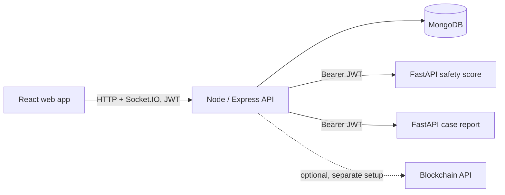

# Travira

Travira is a tourism safety dashboard and API prototype. It contains a React web frontend, a Node/Express API, two FastAPI services, and MongoDB persistence. The repository also includes a separate blockchain integration; the Compose setup below does not start it.

## Architecture



### Location update flow

1. An authenticated client posts coordinates to `POST /api/mobile/location/update`.
2. The Node API validates and stores the location, checks configured geofences, and calls the safety-score service with the caller's JWT.
3. When a score is returned successfully, the API stores it and emits a Socket.IO event to authenticated admin and officer connections. Configured email notifications may be sent for geofence breaches.

The included mobile routes are backend endpoints. This repository does not contain a native mobile application. Email, FCM, AI services, and blockchain integrations require their respective configuration and are not always available in a local run.

## Services

| Component | Responsibility | Local address |
| --- | --- | --- |
| Frontend | React/Vite browser dashboard | http://localhost:3000 |
| Backend | Express API, JWT auth, MongoDB persistence, Socket.IO | http://localhost:5000 |
| Safety score | FastAPI model inference | http://localhost:8001 |
| Case report | FastAPI PDF generation | http://localhost:8002 |
| MongoDB | Application data | Internal Compose network |

## Run with Docker Compose

Prerequisites: Docker Desktop with Compose v2. The Compose stack starts MongoDB, the backend, both FastAPI services, and the frontend. It does not start the blockchain service.

```powershell
Copy-Item .env.example .env
# Edit .env and replace JWT_SECRET with a random secret of at least 32 characters.
docker compose up --build
```

Use the same `JWT_SECRET` for the backend and both FastAPI services. The backend API is at `http://localhost:5000`; the web app is at `http://localhost:3000`. Stop the stack with `docker compose down`. Add `-v` only if you intend to delete the local MongoDB volume and its data.

The demo database can be populated with `docker compose exec backend node seed.js`. **The seed script deletes existing tourist, incident, and geofence records and selected demo users before inserting sample data.** Use it only with disposable data.

## Run services manually

Install dependencies with `npm install`, `npm --prefix backend install`, `npm --prefix frontend install`, and install each Python `requirements.txt`. Set `MONGODB_URI`, `JWT_SECRET`, and the AI service URLs in the environment before starting the backend. Set the same `JWT_SECRET` in the environments for both FastAPI services. For the frontend, set `VITE_API_BASE_URL=http://localhost:5000`.

From the repository root, start each process in its own terminal:

```powershell
npm run dev
npm run backend
npm run ai:safety
npm run ai:case
```

The Python commands require the matching service requirements to be installed. The `backend` command loads the root `.env` through `dotenv`. The Python processes inherit environment variables from the shell; `.env` is not loaded automatically by Uvicorn.

## Authentication and request behavior

- `POST /api/login`, `POST /api/register`, `POST /api/mobile/auth/login`, and `GET /api/health` are public. Other `/api` routes require a signed `Bearer` JWT.
- Public registration creates tourist accounts only. An authenticated admin can create other roles through the same endpoint.
- Socket.IO requires the JWT in the handshake `auth.token`; the server sends location and incident events to authenticated admin and officer sockets.
- The safety-score `/calculate` and case-report `/report` endpoints require a valid JWT signed with the same `JWT_SECRET`.
- Error responses use an `error` message and a stable `code`. Validation errors may include field details.
- Express JSON request bodies are limited to 1 MB. Location, score, incident, and report inputs have basic type and range checks.

See [DESIGN_DECISIONS.md](DESIGN_DECISIONS.md) for service boundaries, trade-offs, and known scaling limits.

## Checks currently available

- `npm --prefix frontend run build` builds the web frontend.
- `npm --prefix backend run test:all` runs backend integration and concurrent score-history regression tests against a disposable MongoDB; the integration suite also needs both FastAPI services running.
- `python -m pytest -q test_api_integration.py` in each `AI_services` directory runs that FastAPI service's auth and validation suite (install `pytest` and `httpx` first).
- GitHub Actions runs all three suites on push. The frontend `test` script remains a placeholder, not a test suite.

## Benchmarks

The benchmark is **API-level, local Compose**. It repeatedly exercises authenticated location updates through the Node API, MongoDB persistence, geofence evaluation, and the safety-score service. It does not measure WebSocket delivery or a deployed environment. Each request rotates among the supplied accounts.

```powershell
# Create at least 20 distinct tourist accounts in the Compose database first.
$env:BENCH_USERNAMES = (1..20 | ForEach-Object { 'tourist_{0:D2}' -f $_ }) -join ','
$env:BENCH_PASSWORD = 'the-shared-test-account-password'
npm run bench:matrix
```

The matrix runs concurrency 1, 5, 10, and 30 three times each for 30 seconds per run. The location-update command supports a single `BENCH_USERNAME` or a comma-separated `BENCH_USERNAMES` list; the matrix command requires at least 20 distinct names. Raw per-run JSON is saved under `benchmarks/`.

### Measured results: API-level, local Compose

Measured on 2026-11-09 from a Windows_NT 10.0.26300 x64 client (Node v22.19.0, 16 logical CPU cores, 16372613120 bytes RAM), against one local Compose backend instance. Docker Engine 28.5.1 reported 16 CPUs and 7927427072 bytes; backend Node v20.20.2; both FastAPI services 0.162.2; scikit-learn 1.9.1; ReportLab 5.1.0. Twenty distinct tourist accounts were used in every run; the disposable database had no geofences. Percentiles use successful responses only. No deployed run was performed.

| Concurrency | Run | Requests | Errors | Success rate | p50 (ms) | p95 (ms) | p99 (ms) | Successful req/s |
| ---: | ---: | ---: | ---: | ---: | ---: | ---: | ---: | ---: |
| 1 | 1 | 523 | 0 | 100% | 56.6977999999981 | 61.5317 | 74.8804999999993 | 17.40645787841212 |
| 1 | 2 | 512 | 0 | 100% | 56.98980000000029 | 69.8393000000001 | 81.50430000000051 | 17.03923599580137 |
| 1 | 3 | 524 | 0 | 100% | 56.03059999999823 | 64.90509999999995 | 81.57359999999971 | 17.441607263015456 |
| 5 | 1 | 702 | 0 | 100% | 211.52440000000206 | 263.9419999999991 | 308.5473000000002 | 23.239455489361657 |
| 5 | 2 | 689 | 0 | 100% | 217.01889999999912 | 270.78689999999915 | 305.83000000000175 | 22.861320103338077 |
| 5 | 3 | 691 | 0 | 100% | 214.95659999999998 | 269.3617000000013 | 298.8110000000015 | 22.976446943990744 |
| 10 | 1 | 684 | 0 | 100% | 440.7714999999989 | 540.7574999999997 | 603.4361000000026 | 22.57497058619951 |
| 10 | 2 | 690 | 0 | 100% | 436.813299999998 | 536.5499999999993 | 601.3221000000012 | 22.730006467246856 |
| 10 | 3 | 683 | 0 | 100% | 441.3152999999984 | 551.6358 | 593.962300000001 | 22.587110731071487 |
| 30 | 1 | 688 | 0 | 100% | 1355.6654999999992 | 1749.335000000001 | 1938.8741 | 22.629230494760264 |
| 30 | 2 | 694 | 0 | 100% | 1347.003 | 1650.4972000000016 | 1849.4457000000002 | 22.604253430642494 |
| 30 | 3 | 684 | 0 | 100% | 1380.7879000000003 | 1764.7122000000018 | 1909.8804000000018 | 22.242312276445254 |

Raw output for every run: [results-local-compose-2026-11-09.json](benchmarks/results-local-compose-2026-11-09.json).

## Scope and known limitations

- Safety-score training labels are generated from synthetic rules; model evaluation is not evidence of real-world safety prediction accuracy.
- Some dashboard analytics and alert content remain demo-oriented. Verify the source data before presenting those panels as operational analytics.
- The benchmark used one backend instance. Socket.IO broadcasts remain in-process and use one staff room; they are not shared across multiple backend instances.
- JWTs use shared-secret HS256. There is no token revocation or key rotation.
- Geofence geometry/query consistency and database query performance still need dedicated correctness and load work.
- The automated suites exercise selected auth, validation, location, scoring, persistence, socket, panic, and concurrency paths; they do not establish production reliability or broad test coverage.

## Project scripts

| Command | Action |
| --- | --- |
| `npm run dev` | Start the Vite frontend on port 3000 |
| `npm run backend` | Start the Express backend on port 5000 (requires backend dependencies) |
| `npm run ai:safety` | Start the scoring API on port 8001 |
| `npm run ai:case` | Start the report API on port 8002 |
| `npm run compose:up` | Build and start the Compose stack |
| `npm run compose:down` | Stop the Compose stack |
| `npm run bench:location` | Benchmark authenticated location updates (set `BENCH_USERNAME` and `BENCH_PASSWORD`) |
