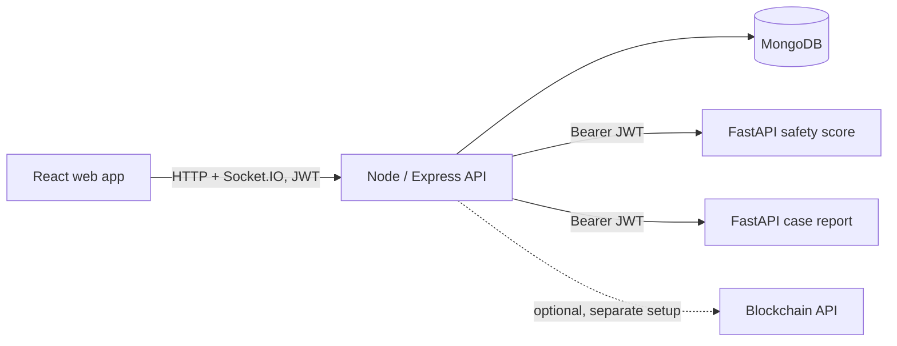

# Travira

Travira is a tourism safety dashboard and API prototype. It contains a React web frontend, a Node/Express API, two FastAPI services, and MongoDB persistence. The repository also includes a separate blockchain integration; the Compose setup below does not start it.

## Architecture



### Location update flow

1. An authenticated client posts coordinates to `POST /api/mobile/location/update`.
2. The Node API validates and stores the location, checks configured geofences, and calls the safety-score service with the caller's JWT.
3. When a score is returned successfully, the API stores it and emits a Socket.IO event to authenticated admin and officer connections. Configured email notifications may be sent for geofence breaches.

The included mobile routes are backend endpoints. This repository does not contain a native mobile application. Email, FCM, AI services, and blockchain integrations require their respective configuration and are not always available in a local run.

## Services

| Component | Responsibility | Local address |
| --- | --- | --- |
| Frontend | React/Vite browser dashboard | http://localhost:3000 |
| Backend | Express API, JWT auth, MongoDB persistence, Socket.IO | http://localhost:5000 |
| Safety score | FastAPI model inference | http://localhost:8001 |
| Case report | FastAPI PDF generation | http://localhost:8002 |
| MongoDB | Application data | Internal Compose network |

## Run with Docker Compose

Prerequisites: Docker Desktop with Compose v2. The Compose stack starts MongoDB, the backend, both FastAPI services, and the frontend. It does not start the blockchain service.

```powershell
Copy-Item .env.example .env
# Edit .env and replace JWT_SECRET with a random secret of at least 32 characters.
docker compose up --build
```

Use the same `JWT_SECRET` for the backend and both FastAPI services. The backend API is at `http://localhost:5000`; the web app is at `http://localhost:3000`. Stop the stack with `docker compose down`. Add `-v` only if you intend to delete the local MongoDB volume and its data.

The demo database can be populated with `docker compose exec backend node seed.js`. **The seed script deletes existing tourist, incident, and geofence records and selected demo users before inserting sample data.** Use it only with disposable data.

## Run services manually

Install dependencies with `npm install`, `npm --prefix backend install`, `npm --prefix frontend install`, and install each Python `requirements.txt`. Set `MONGODB_URI`, `JWT_SECRET`, and the AI service URLs in the environment before starting the backend. Set the same `JWT_SECRET` in the environments for both FastAPI services. For the frontend, set `VITE_API_BASE_URL=http://localhost:5000`.

From the repository root, start each process in its own terminal:

```powershell
npm run dev
npm run backend
npm run ai:safety
npm run ai:case
```

The Python commands require the matching service requirements to be installed. The `backend` command loads the root `.env` through `dotenv`. The Python processes inherit environment variables from the shell; `.env` is not loaded automatically by Uvicorn.

## Authentication and request behavior

- `POST /api/login`, `POST /api/register`, `POST /api/mobile/auth/login`, and `GET /api/health` are public. Other `/api` routes require a signed `Bearer` JWT.
- Public registration creates tourist accounts only. An authenticated admin can create other roles through the same endpoint.
- Socket.IO requires the JWT in the handshake `auth.token`; the server sends location and incident events to authenticated admin and officer sockets.
- The safety-score `/calculate` and case-report `/report` endpoints require a valid JWT signed with the same `JWT_SECRET`.
- Error responses use an `error` message and a stable `code`. Validation errors may include field details.
- Express JSON request bodies are limited to 1 MB. Location, score, incident, and report inputs have basic type and range checks.

See [DESIGN_DECISIONS.md](DESIGN_DECISIONS.md) for service boundaries, trade-offs, and known scaling limits.

## Checks currently available

- `npm --prefix frontend run build` builds the web frontend.
- `python AI_services/safety_score/test_model.py` exercises manual scoring scenarios; set a valid bearer token in the script/client when running after service authentication is enabled.
- The repository does not currently define a backend integration test suite or CI workflow. The frontend `test` script is still a placeholder and is not a test suite.

## Benchmarks

The benchmark uses Node's built-in `fetch`; it logs in once and repeatedly exercises the authenticated location-update endpoint. That path includes MongoDB persistence, geofence evaluation, and the safety-score service. It reports p50/p95/p99 latency, successful requests per second, failures, concurrency, client hardware, and Node version.

```powershell
$env:BENCH_USERNAME = 'tourist1'
$env:BENCH_PASSWORD = 'your-demo-password'
$env:BENCH_CONCURRENCY = '1'
$env:BENCH_DURATION_SECONDS = '30'
npm run bench:location
```

### Measured results

The following were run locally against Docker Compose, with an empty geofence collection and one tourist account. Latency percentiles below use successful responses only; the JSON output also reports percentiles across all responses.

| Run | Test conditions | Requests | Errors | p50 | p95 | p99 | Successful req/s |
| --- | --- | ---: | ---: | ---: | ---: | ---: | ---: |
| 2026-11-09 local baseline | 30 s, concurrency 1; Windows 10.0.26300 x64 client, Node v22.19.0, 16 logical cores / 15.25 GiB host memory; Docker Engine 28.5.1 assigned 16 CPUs / 7.38 GiB; backend Node v20.20.2; FastAPI 0.162.2; scikit-learn 1.9.1 | 443 | 0 (0%) | 64.35 ms | 84.20 ms | 100.43 ms | 14.77 |
| 2026-11-09 same-account diagnostic | 5 s, concurrency 5, same client and Compose stack | 102 | 81 (79.41%) | 233.95 ms | 296.10 ms | 369.71 ms | 4.11 |

The concurrency-5 diagnostic returned HTTP 500 for its 81 failures. The underlying cause has not been isolated; treat that result as a concurrency limitation, not as a capacity claim. This was a local run only; no deployed benchmark was performed.

## Scope and known limitations

- Safety-score training labels are generated from synthetic rules; model evaluation is not evidence of real-world safety prediction accuracy.
- Some dashboard analytics and alert content remain demo-oriented. Verify the source data before presenting those panels as operational analytics.
- Socket.IO broadcasts are process-local and use one staff room; there is no multi-instance adapter or per-tourist subscription model.
- Geofence geometry/query consistency and database query performance still need dedicated correctness and load work.
- There is no automated CI workflow. The current automated coverage is limited, so do not claim measured test coverage or production reliability.

## Project scripts

| Command | Action |
| --- | --- |
| `npm run dev` | Start the Vite frontend on port 3000 |
| `npm run backend` | Start the Express backend on port 5000 (requires backend dependencies) |
| `npm run ai:safety` | Start the scoring API on port 8001 |
| `npm run ai:case` | Start the report API on port 8002 |
| `npm run compose:up` | Build and start the Compose stack |
| `npm run compose:down` | Stop the Compose stack |
| `npm run bench:location` | Benchmark authenticated location updates (set `BENCH_USERNAME` and `BENCH_PASSWORD`) |
